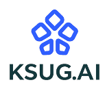
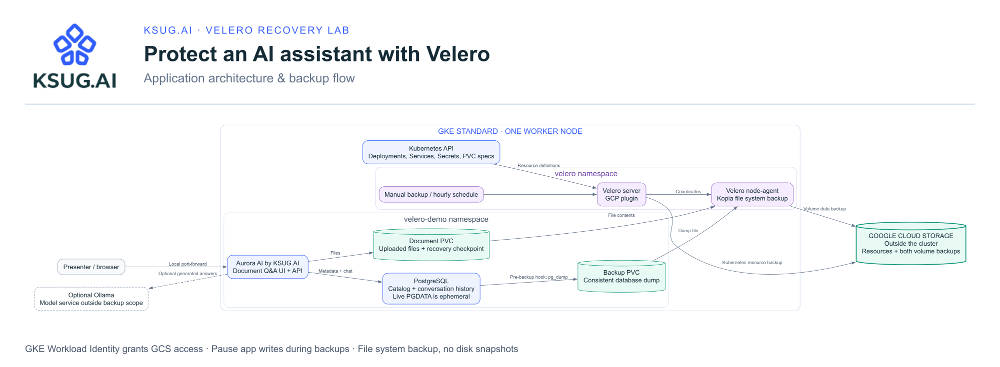

[](https://ksug.ai)

# KSUG.AI · Recover an AI assistant with Velero

A presentation and hands-on demo of Velero on Google Kubernetes Engine (GKE), protecting a small document Q&A assistant backed by PostgreSQL and Google Cloud Storage (GCS) backups.

Upload a knowledge document, ask a question, back up the application, delete its namespace, and restore the documents and conversation history. An hourly schedule demonstrates automation.

The app is called **KSUG.AI Aurora AI**. Its default rehearsal mode returns matching document excerpts, with no model or API key required. Optionally connect an Ollama model for generated answers. The UI clearly identifies the active mode.

## Architecture

[](https://ksug.ai)

[Download SVG](docs/diagrams/architecture.svg) · [Download PNG](docs/diagrams/architecture.png)

The backup contains **Kubernetes resources, uploaded documents, and a PostgreSQL dump**. GCS keeps that data outside the cluster. Restore recreates the resources and both volumes, then `demo.sh` imports the database dump and verifies the recovered files and conversation history.

Velero uses GKE Workload Identity to access GCS. Pause uploads and questions while a backup runs. See [the restore sequence and architecture notes](docs/ARCHITECTURE.md) for the detailed flow. [Editable diagram sources](docs/diagrams/README.md).

## Demo design

- One-node, zonal GKE Standard cluster on the Regular release channel.
- Velero server and node-agent, with the GCP object-store plugin.
- Workload Identity Federation for GKE; no downloaded service-account keys.
- A PostgreSQL backup hook runs `pg_dump` into a PVC. Velero file system backup copies that volume to GCS along with the namespace resources.
- Uploaded documents live on a second PVC; document metadata and conversation history live in PostgreSQL.
- Restore recreates Kubernetes resources and both backed-up volumes. `demo.sh restore` imports the dump and checks document hashes and the conversation history against a backup checkpoint.

PostgreSQL's live data directory is deliberately ephemeral. This keeps the demonstration focused on recovering an application-consistent logical dump rather than copying live database files. Pod replacement loses changes since the last dump; this configuration is for a disposable demo, not production. The dump covers the `demo` database, not cluster-wide roles or other databases.

## Prerequisites

Use Google Cloud Shell or Bash with `gcloud`, `kubectl`, the GKE auth plugin, `curl`, `tar`, and Python 3. Scripts automatically download the pinned **Velero v1.18.1 CLI** from the [official release](https://github.com/velero-io/velero/releases/tag/v1.18.1), verify its SHA-256 against the release CHECKSUM file, and cache it in the ignored `.tools/` directory. No sudo or shell PATH changes are required. An existing matching CLI on PATH is reused. For manual CLI commands, use `./velero.sh`, for example `./velero.sh backup get`. The server and node-agent are installed separately by `velero-deploy.sh` (also run by `setup.sh`).

You need a billing-enabled Google Cloud project, quota for the cluster and disks, and permission to enable APIs, create GKE clusters and buckets, manage the demo service account and IAM bindings, and administer Kubernetes resources. The default VPC must exist. Cloud resources incur charges.

## Quick start

From this repository:

```bash
export MY_PROJECT_ID=automatic-hawk-379007 # Replace this with your own project id
# Optional: override MY_CLUSTER, MY_REGION, MY_ZONE, MY_BUCKET in your shell.
# If changing the region, also choose a zone within that region.
./setup.sh
kubectl -n velero-demo port-forward svc/ai-assistant 8080:8080
```

Open http://localhost:8080 (or Cloud Shell Web Preview on port 8080). Upload `ai-app/sample-docs/recovery-plan.md`, then ask **"What is the recovery passphrase?"**. You should see `nebula-orchid-42` in the answer. Leave the app idle while backing up in a second terminal:

```bash
export MY_PROJECT_ID=automatic-hawk-379007 # Replace this with your own project id
./demo.sh backup demo-01 && ./demo.sh verify demo-01
```

`setup.sh` creates the configured cluster or reconnects to an existing running cluster in the same zone, deploys PostgreSQL, builds **and deploys** Aurora, and installs Velero. It stops on failure before printing success. You still need the other prerequisite CLIs installed and valid cloud permissions/quota.

For individual steps, run `./createsa.sh`, `./gke-deploy.sh` (new clusters only), `./postgresql-deploy.sh`, `./ai-app/build-and-push.sh`, and `./velero-deploy.sh` in that order. The build script now deploys automatically; there is no command to copy from its output. Use `./ai-app/build-and-push.sh --build-only` only when you intentionally want an image without a deployment.

`demo.sh verify BACKUP_NAME` first requires a completed backup and completed backups of both volumes, then checks local app/checkpoint consistency. It does not prove a restore occurred. `demo.sh restore BACKUP_NAME` performs the actual recovery and then verifies it. A failed backup must never be followed by namespace deletion.

The build script uses Cloud Build and Artifact Registry and incurs build/storage charges. Your build identity needs permission to push images, and the GKE node identity needs Artifact Registry Reader access to the repository. Reusing an image is supported: set `AI_APP_IMAGE` to an existing pushed image before `./setup.sh` to skip the build, or run `./ai-app-deploy.sh` to deploy only that image. No image is built or pushed automatically during a restore.

Use a globally unique bucket name dedicated to this demo. Keep the same environment settings across terminal sessions. `setenv.sh` contains defaults; every gcloud operation specifies the project. Kubernetes scripts check the expected context before making changes. Cluster creation is a one-time operation; if it already exists, reconnect with:

```bash
source ./setenv.sh
gcloud container clusters get-credentials "$MY_CLUSTER" --project "$MY_PROJECT_ID" --zone "$MY_ZONE"
```

Continue with [the presenter runbook](LAB_GUIDE.md) for the deletion, restore, scheduling, troubleshooting, and cleanup steps. [The review notes](REVIEW.md) record what changed from the inherited repository.

## Repository map

| File | Purpose |
| --- | --- |
| `velero.sh` | Run the pinned CLI without installing it on your shell PATH |
| `setup.sh` | Provision or reconnect, deploy PostgreSQL and Aurora, then install Velero |
| `cleanup.sh` | Preview, remove, and verify all dedicated demo resources |
| `setenv.sh` | Overridable demo defaults |
| `createsa.sh` | Enable required Google Cloud APIs (legacy filename) |
| `gke-{deploy,destroy}.sh` | Create or delete the exact configured cluster |
| `postgresql-{deploy,destroy}.sh` | Deploy/seed or delete the demo namespace |
| `manifests/postgresql.yaml` | PostgreSQL, dump PVC, service, and backup hook |
| `ai-app/` | Q&A UI, retrieval, optional Ollama connection, and recovery checks |
| `ai-app-deploy.sh` | Deploy a previously built app image |
| `manifests/ai-app.yaml` | App, document PVC, settings, and checkpoint hook |
| `velero-{deploy,destroy}.sh` | Configure bucket/IAM and install or uninstall Velero |
| `velero-schedule.yaml` | Hourly backups with 24-hour retention |
| `demo.sh` | Seed, query, back up, and restore the sample data |

## Optional model and local development

See [ai-app/README.md](ai-app/README.md) for Ollama configuration, local development, and tests. No model weights or external model service are required for the default demo.

Backups of the database and document PVC are separate operations. Pause uploads and questions during a backup, including scheduled runs, to keep the demo checkpoint consistent. This lab does not implement a distributed write freeze. A restore verification fails if the recovered catalog, files, or conversation history disagree.

## Cleanup after the demo

```bash
./cleanup.sh          # Preview using your deployment environment settings
./cleanup.sh --apply  # Confirm and remove the dedicated demo resources
```

Keep `MY_PROJECT_ID`, `MY_ZONE`, and other overrides set to the deployment values. See [automated cleanup](docs/CLEANUP.md) for scope, unattended use, retention limits, and verification reports.

## References

- [Velero file system backup](https://velero.io/docs/main/file-system-backup/)
- [Velero backup hooks](https://velero.io/docs/main/backup-hooks/)
- [GCP plugin setup and compatibility](https://github.com/velero-io/velero-plugin-for-gcp)

The defaults pair Velero 1.18.x with GCP plugin 1.14.x according to the compatibility table. The full backup/delete/restore flow passed on GKE 1.36.4; see [the cloud rehearsal results](REHEARSAL.md). Rehearse against your chosen project and cluster before presenting.
