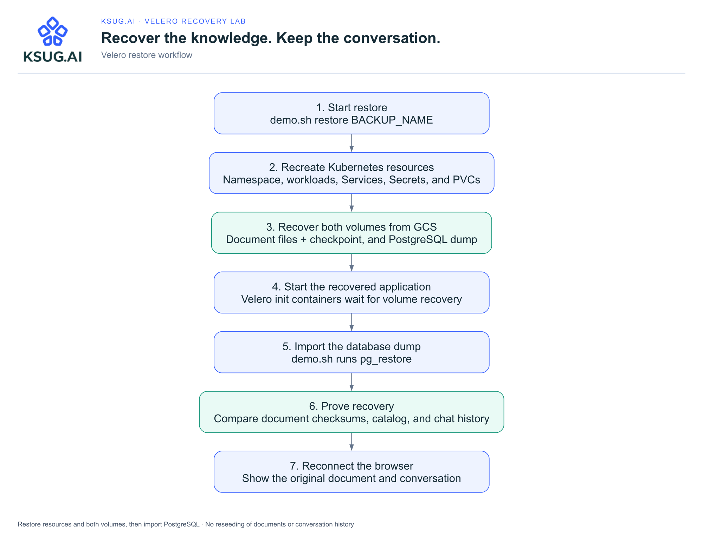

# KSUG.AI · Demo architecture

The main architecture diagram is embedded in the [README](../README.md#architecture). The logo is embedded in the diagram itself. Download [SVG](diagrams/architecture.svg) or [PNG](diagrams/architecture.png); see [editable sources and regeneration](diagrams/README.md).

The application has two kinds of valuable state: uploaded knowledge files on the document PVC, and the document catalog and conversations in PostgreSQL. Before a backup, the app hook writes a recovery checkpoint onto the document PVC and the PostgreSQL hook writes a logical dump onto the backup PVC. The node-agent copies both volumes to GCS. Velero separately saves the Kubernetes resource definitions, including the application Secret.

GCS is outside the GKE cluster. Deleting the demo namespace removes the app and its PVCs, while the backups remain available. This demo uses file system backup; it does not take cloud disk snapshots. PostgreSQL's live PGDATA directory is intentionally ephemeral and is recovered through the logical dump.

## Restore sequence

[Download SVG](diagrams/restore.svg) · [Download PNG](diagrams/restore.png)

## Identity and optional services

The Velero Kubernetes service account uses GKE Workload Identity to access the dedicated Google service account. That identity has object access on the backup bucket and token-signing permission on itself. No downloaded service-account key is used. This backup path does not need Compute Engine snapshot permissions.

The default Q&A mode extracts matching document paragraphs and needs no model endpoint. An optional Ollama endpoint generates answers from those excerpts. Model weights and the external model service are outside the backup scope. The container image is built by Cloud Build, stored in Artifact Registry, and must remain available for a restored deployment to start.

## Demo consistency boundary

Keep the app idle while any backup runs. The two volume backups and PostgreSQL dump do not form a distributed atomic snapshot. The recovery checkpoint detects mismatched document contents, catalog entries, or conversations after restore; it does not freeze writes. See [the presenter runbook](../LAB_GUIDE.md) and [validated rehearsal](../REHEARSAL.md).
